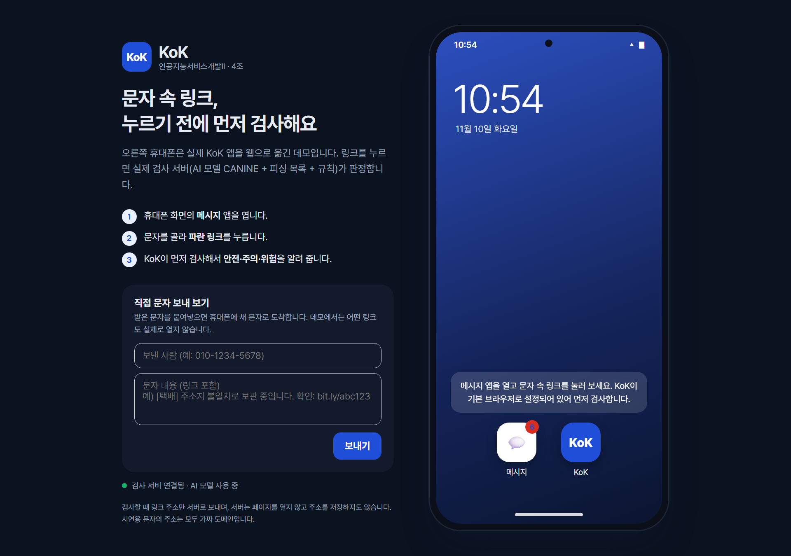
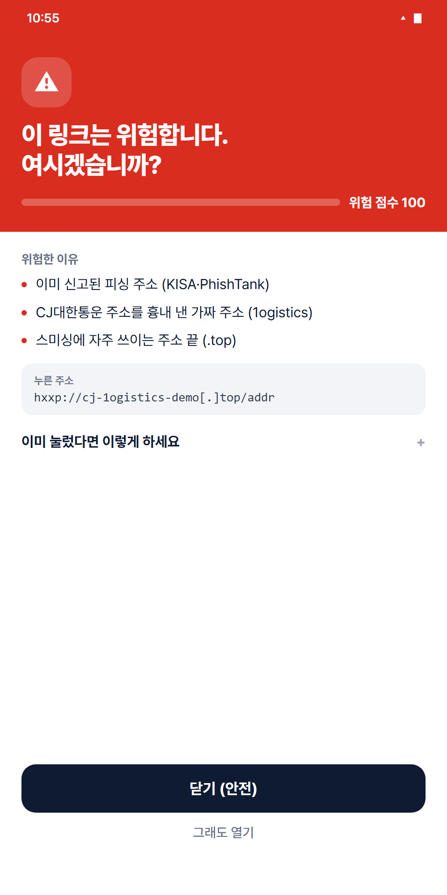
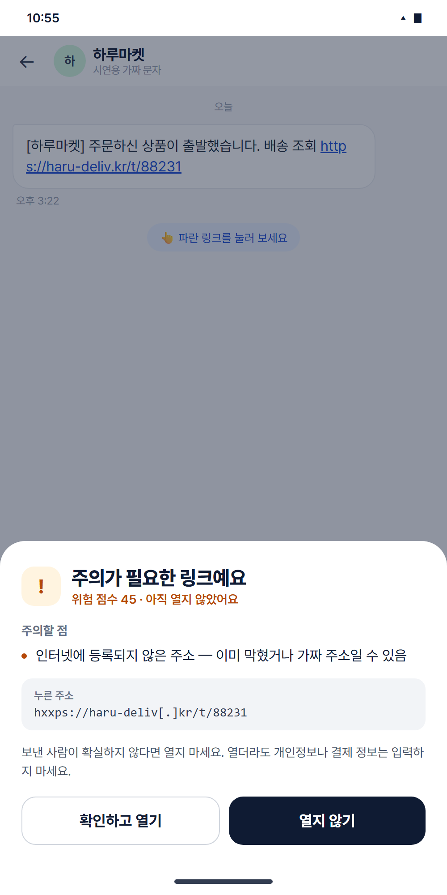

# KoK 웹 데모

문자 속 링크를 **누르기 전에** 스미싱인지 먼저 검사해 주는 안드로이드 앱 **KoK**을, 설치 없이 브라우저에서 체험하는 데모입니다.
(인공지능서비스개발II 4조 · 이혜리, 김서은)

**👉 체험하기: https://6hzl-kok-demo.static.hf.space**  (GitHub Pages: https://hyeri222.github.io/kok-web-demo/)

## 사용법
1. 오른쪽 휴대폰 화면에서 **메시지** 앱을 엽니다.
2. 문자를 골라 **파란 링크**를 누릅니다.
3. KoK이 먼저 검사해서 **안전 · 주의 · 위험 · 확인 못 함**을 알려 줍니다.
4. 왼쪽 **"직접 문자 보내 보기"**에 받은 문자를 붙여넣으면 새 문자로 도착합니다.

| 위험 경고 | 주의 확인 창 |
|:---:|:---:|
|  |  |

## 동작 방식
- 화면은 이 `index.html` 한 파일(HTML·CSS·JavaScript)입니다.
- 링크를 누르면 주소만 **KoK 검사 서버**로 보냅니다. 서버는 공식 주소 목록 → 피싱 목록(KISA·PhishTank) → 단축 URL 풀기 → **직접 미세조정한 CANINE AI** → 규칙·주소 정보 보정 순서로 판정합니다.
- 검사 서버 주소는 [Hugging Face의 endpoint.txt](https://huggingface.co/6hzl/kok-canine)에서 읽어 옵니다. 서버가 꺼져 있으면 왼쪽 아래에 빨간 점이 표시됩니다.
- **데모에서는 어떤 링크도 실제로 열지 않습니다.** 시연용 문자의 주소는 가짜 도메인이거나 실제 공식 사이트입니다.

## 발표용 바로 가기
주소 뒤에 `#shot=`과 화면 이름을 붙이면 그 화면이 바로 열립니다.

| 화면 | 주소 |
|---|---|
| 문자 목록 | `#shot=inbox` |
| 위험 | `#shot=danger` |
| 주의 | `#shot=caution` |
| 확인 못 함 | `#shot=unknown` |
| KoK 홈 | `#shot=kok` |
| 검사 기록 | `#shot=history` |

예) https://6hzl-kok-demo.static.hf.space/#shot=danger

## 관련 링크
- AI 모델: https://huggingface.co/6hzl/kok-canine
- 폰트: [Pretendard](https://github.com/orioncactus/pretendard) (SIL OFL 1.1)
